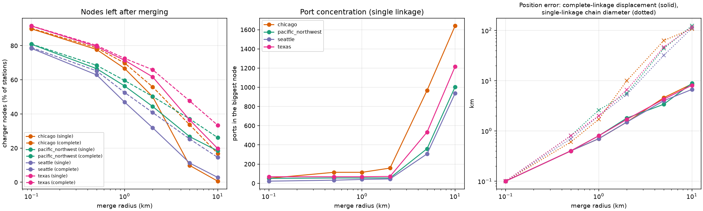

# Real-network case studies (asymmetric energy and time)

Each folder is a drop-in replacement for the California data in `EVRoutingEnv/data/`: same file
names, same key format, same units (kWh, hours). Point `network.data_path` at the folder and the
environment, baselines and plotting work unchanged. The generated configs are `config_joint.yaml`
with only `network.data_path` changed, so fleet size, payload, 400 kWh battery, charging curves
(150/350/750 kW classes), traffic noise and rewards match the California runs.

| Case | Config | Extent | Nodes: chargers / depots / delivery | DC-fast ports | Median leg | Max leg | Terrain |
|---|---|---|---|---|---|---|---|
| **Texas** | `config_joint_texas.yaml` | 1260 km | 882: 648 / 4 / 230 | 5665 | 449 kWh | 1863 kWh | flat to hilly, 0-2040 m |
| **Pacific Northwest** (WA + OR) | `config_joint_pacific_northwest.yaml` | 790 km | 726: 492 / 4 / 230 | 3772 | 470 kWh | 1729 kWh | Cascades and Coast Range, 0-2950 m |
| Puget Sound (Seattle) | `config_joint_seattle.yaml` | 118 km | 329: 96 / 3 / 230 | 952 | 57 kWh | 203 kWh | hilly, 0-590 m |
| Chicagoland | `config_joint_chicago.yaml` | 107 km | 444: 210 / 4 / 230 | 1644 | 52 kWh | 168 kWh | flat, 165-306 m |
| **California** (original data, `california/`) | `config_joint_california.yaml` (same as `config_joint.yaml`) | about 1250 km | 258: 25 / 0 / 233 | 209 (10 DC-fast + 15 Level 2 stations) | 326 kWh | 1411 kWh | Sierra, coast ranges, deserts; nodes at -10 to 1290 m, roads up to 3040 m |

With a 400 kWh battery, the **state-scale cases (Texas, Pacific Northwest) are the ones where charging
decisions matter**, like California: the median leg is longer than the battery, so most legs need a
charging stop on the way. The two metro cases are small: no scenario drawn from them needed charging
(see "Scenario check"), so use them for asymmetry and dense-charger experiments, or lower `battery_kwh`.

Run one: `python scripts/casestudies/smoke_episode.py EVRoutingEnv/config_files/config_joint_texas.yaml --plot`
(the first load of a large case computes all-pairs routes in pure Python: 1 to 13 minutes, cached in
the system temp folder afterwards; set `TMPDIR` to keep it).

## What is real and what is modelled

| Layer | Source | Used for |
|---|---|---|
| Delivery nodes, metros | Amazon Last Mile Routing Research Challenge 2021 (real driver routes, CC BY-NC 4.0) | 230 random real stops per metro, plus the real depot ("station") locations |
| Delivery nodes, states | OpenStreetMap `place` nodes (city, town, village with a population tag), like California's city-to-city lanes | 230 places drawn with probability proportional to sqrt(population), at least 5 km apart; the 4 largest become the depot nodes (Houston, Dallas, San Antonio, Fort Worth in Texas) |
| Road network | OpenStreetMap via Geofabrik (ODbL). One-ways and speed limits respected; service roads excluded; state cases keep motorway to `unclassified` classes only | directed graph, largest strongly connected component (3.5M nodes for each state case) |
| Slope | AWS terrain tiles (USGS 3DEP/NED over the US; SRTM, EU-DEM and national DEMs over Europe): about 13 m per pixel for metros, 52 m for the Pacific Northwest, 100 m for Texas, 48 m for Germany + Netherlands + Belgium | node elevation, smoothed along the road graph (60-300 m scale); bridge and tunnel nodes interpolated between their land ends; offshore bathymetry values reset to sea level |
| Chargers, US | NREL/NLR Alternative Fuels Data Center, public open DC-fast stations only | **every** site in the area, one node per site, `total_capacity` = DC-fast ports |
| Chargers, Europe | OpenStreetMap `amenity=charging_station` (ODbL): CCS, CHAdeMO and NACS sockets with a tagged output of at least 50 kW (untagged outputs are kept) | Germany + Netherlands + Belgium: all DC sites are read and merged within 1 km, and a coverage-spread subset of the merged sites becomes the charger nodes (see "Charger nodes") |
| Energy and time | modelled (below) | all-pairs minimum-energy routes between the nodes |

Delivery demand, service times and time windows are **not** taken from the data sources; they come from
the environment config exactly as in the California runs.

### Charger nodes
Only DC-fast ports are counted. Stations closer than **1 km** (single linkage) are one node and their
ports add up (`vis_data/stations.json` lists the member stations, networks, connectors and cluster
diameter; chains can reach 2-2.6 km). Sites that snap to the same road node are also combined. The AFDC
lists Tesla-only connectors too; set `exclude_tesla_only: true` in the preset to drop them. Set
`max_chargers: N` to keep only N sites chosen for coverage.

Outside the US there is no AFDC, so `chargers_source: osm` reads the DC sockets of
`amenity=charging_station` nodes and areas from the same Geofabrik extracts as the roads. A station's ports are
the largest per-type DC socket count (CCS, CHAdeMO and Tesla/NACS plugs usually share a dispenser, and Tesla
sites repeat their stalls under three tag keys), capped by the `capacity` tag; stations tagged private or
non-car are skipped, and a node mapped twice within 15 m (same operator and ports) is counted once. Both
the ids in `stations.json` (`afdc_ids`, kept under this name so the tooling is shared) and the
`names`/`networks` fields come from OSM (`node/<id>`, `way/<id>`, name or brand, operator). OSM tagging is
community-maintained, so counts are less uniform than AFDC.

Merge radius versus node count, DC-fast stations of each study area (ports are always preserved).
Cells show **single linkage / complete linkage** (single: chains of nearby stations join; complete: every
pair inside a node is within the radius). Nodes before snapping to the road network, which merges a few more:

| radius | Texas (907) | Pacific Northwest (876) | Seattle (213) | Chicago (315) |
|---|---|---|---|---|
| none | 907 | 876 | 213 | 315 |
| 100 m | 830 / 831 | 708 / 709 | 167 / 168 | 283 / 284 |
| 500 m | 721 / 727 | 583 / 600 | 134 / 139 | 245 / 248 |
| 1 km | 648 / 658 | 494 / 522 | 100 / 112 | 210 / 220 |
| 2 km | 560 / 598 | 389 / 440 | 68 / 87 | 158 / 176 |
| 5 km | 331 / 432 | 234 / 325 | 24 / 54 | 31 / 106 |
| 10 km | 179 / 303 | 161 / 229 | 6 / 31 | 2 / 53 |



- Going from 1 km to 10 km removes 55-75 % of the nodes with complete linkage, and up to 99 % with single linkage.
- **Single linkage stops being usable above 2 km**: it chains neighbouring towns into one node (Chicago 31 nodes at 5 km
  and 2 at 10 km, chains 63-124 km long, 360-1216 ports in one node). The default stays at 1 km single linkage.
- Complete linkage keeps nodes compact (largest centre displacement 3-5 km at 5 km, 7-9 km at 10 km, ports per node
  up to 143) and is what to use for a coarse charger set: `charger_merge_m: 5000` with `charger_merge_linkage: complete`
  gives 432 (Texas), 325 (Pacific Northwest), 54 (Seattle), 106 (Chicago) nodes before snapping.
- Larger radii also move charger positions (a station is up to the displacement away from its node), so use them
  for experiments on charger density, not to model real stations. `scripts/casestudies/charger_merge_sweep.py`
  regenerates the table, `charger_merge_sweep.json` and the figure; the full numbers (ports, diameters,
  displacement) are in the JSON.

### Energy and time model
Per directed road segment, from the slope of the smoothed elevation profile:

- time = length / (posted speed x class factor) + signal (20 s) / stop-sign (8 s) delay at the head node;
- battery energy = traction (gravity + rolling + drag) divided by the drivetrain efficiency, or
  multiplied by the regeneration efficiency on net-downhill segments, + auxiliary load x time +
  kinetic losses at signals and stop signs;
- vehicle profile `heavy_truck` (default): 36 t class-8 battery-electric truck, Crr 0.007, CdA 6.5 m2,
  drivetrain 0.90, regeneration 0.65, 6 kW auxiliary. These were **calibrated to the California data**
  (median 1.57 kWh/km, 10th-90th percentile 1.13-1.97, from its lane table) rather than read from a
  publication: median over routes is 1.47 (Seattle), 1.25 (Chicago), 1.33 (Pacific Northwest) and
  1.18 (Texas) kWh/km. A `van` profile (4.2 t, about 0.3 kWh/km) is also provided. Parameters are
  recorded in `metadata.json` and overridable in the preset (`vehicle_profile:`, `vehicle:`).

Uphill and downhill, and one-way versus two-way streets, make both costs depend on direction. Routes
minimise battery energy (regeneration allowed on the road graph; exact, via an elevation potential so
Dijkstra applies); the time stored for a pair is the time **on that same route**, as in the California
data. `metadata.json` records the check that energy re-accumulated along each route equals the Dijkstra
value (error below 3e-5 kWh) and that no reduced edge cost was negative.

The environment cannot use negative leg energy, so a pair whose net energy is below 0.02 kWh is
floored to 0.02 kWh (282 of 108k legs in Seattle, 71 of 527k in the Pacific Northwest, 1 each in Chicago and
Texas). The unfloored values are in `vis_data/od_matrices.npz` (`energy_net_kwh`).

### Measured asymmetry (node pairs where both directions exceed 1 kWh / 3 min)

| | energy: median diff | energy: pairs > 5 % | energy: pairs > 20 % | time: pairs > 5 % |
|---|---|---|---|---|
| California | 6.4 % | 57 % | 24 % | 21 % |
| Texas | 8.2 % | 71 % | 7 % | 14 % |
| Pacific Northwest | 7.7 % | 62 % | 15 % | 25 % |
| Seattle | 14.5 % | 81 % | 38 % | 54 % |
| Chicago | 9.8 % | 76 % | 10 % | 21 % |

Seattle's energy asymmetry follows net climb between the two ends (`figures/asymmetry.png`), and its time
asymmetry is high because a 36 t truck's minimum-energy route differs by direction; a lighter vehicle gives
about 22 %. `comparison.png` overlays California and the case studies.

## California in the same layout

`california/` holds the original California data in exactly the layout of the other cases, so the cases can be
loaded, plotted and compared the same way (`config_joint_california.yaml` differs from `config_joint.yaml` only in
`network.data_path`, and gives the same scenarios and results as the original files, which stay in `EVRoutingEnv/data/`).
`scripts/casestudies/import_california.py` creates the folder.

- **Original, copied unchanged:** the energy and time dictionaries, `station_info_dict.json`, `waiting_time_lookup.json`,
  the node and station coordinates (from `vis_data/node_CA_df.json` / `station_CA_df.json`).
- **Derived for comparability:** node elevation, the plotted motorway-to-primary road backdrop and its grade (same OSM +
  terrain pipeline as the other cases), and `metadata.json`/figures. The shipped `vis_data/california_hgv_mw-tr-pr-se.osm`
  is a GraphML file that is cut off mid-edge (about 60 % of its edges), so it is not used.
- **Quirks of the original data** (recorded in `metadata.json`): 25 stations of which only 10 are DC-fast (15 are Level 2);
  delivery nodes are the 233 cities of the freight lanes, concentrated around the Bay Area and Los Angeles; 257 of 66306
  ordered pairs are missing and one node (San Diego, 310981005) is destination-only, so the graph is not strongly
  connected (the environment never uses it as a depot); 18 legs have negative energy and are ignored by the environment;
  road length is known only for the freight lanes, so the figures use straight-line distance; the energy model is not
  documented in the repository (the freight lanes imply a median of 1.57 kWh/km, which the heavy-truck profile of the
  new cases is calibrated to); there are no depots (the environment draws one at random).
- California measured the same way as the others: the heuristic solves 45 % of 20 scenarios, all need charging, median 14
  charge sessions (see the scenario table).

## Scenario check

`scripts/casestudies/check_scenarios.py` resets the environment on 20 seeds per case. Each reset draws a
depot and 10 customers, certifies that the instance is solvable (it raises otherwise), and a heuristic policy
plays the episode. Results are in `<case>/scenario_check.json` and `<case>/figures/scenarios.png`
(`tests/unit/test_case_studies.py` asserts the clean outcome).

| Case | Scenarios played / failed to build | Same seed replays | Distinct depots / customers used | Heuristic success | Scenarios needing charging | Median distance driven | Charge sessions (median, max) | Seconds to generate a scenario |
|---|---|---|---|---|---|---|---|---|
| Texas | 20 / 0 | yes | 19 / 142 | 65 % | 20 of 20 | 4391 km | 20, 295 | 10 |
| Pacific Northwest | 20 / 0 | yes | 19 / 139 | 95 % | 20 of 20 | 3302 km | 18, 24 | 6 |
| Seattle | 20 / 0 | yes | 19 / 143 | 100 % | 0 of 20 | 469 km | 0, 0 | 0.2 |
| Chicago | 20 / 0 | yes | 19 / 139 | 100 % | 0 of 20 | 456 km | 0, 0 | 0.5 |
| California (reference) | 20 / 0 | yes | 20 / 139 | 45 % | 20 of 20 | 7038 km | 14, 149 | 0.6 |

Every scenario was certified solvable. The state-scale cases are non-trivial for the heuristic (Texas fails 35 %,
California 55 %, mostly `no_feasible_action`), the metro cases are solved without any charging (see above).
The Texas failure with 295 charge sessions is a heuristic that loops between chargers, not a data problem.

### Generation speed
A reset draws the depot and customers and then certifies the instance is solvable by constructing and replaying
a witness route through the chargers (`route_certificate.py`). Playing an episode with the heuristic takes
about 4 s even on Pacific Northwest; certification used to take 25-55 s there and grows with the number of
chargers and with how many legs exceed one battery. It is now 2-12 s for the same scenarios (identical
witnesses): vectorised charger scan, vectorised dominance test, a fixed-order charging-time integral (agrees with
the adaptive one to 3e-9) and cached cost matrices. For instant resets, pre-generate scenarios once:

```bash
python scripts/casestudies/generate_scenarios.py EVRoutingEnv/config_files/config_joint_texas.yaml \
    --seeds 0:2000 --workers 16 --out /path/to/scenario_cache
export EVRP_SCENARIO_CACHE=/path/to/scenario_cache   # or environment.scenario_cache_dir in the config
```

`reset(seed=s)` then loads the stored, certified instance in about 30 ms and the episode is identical to one
generated on the spot (the cache key covers the seed, the whole config and the network).

## Folder contents

```
<case>/
  shortest_path_energy_dict.json   "(u, v)" -> kWh, all ordered pairs of the nodes   (get_graph reads this)
  shortest_path_time_dict.json     "(u, v)" -> hours on the same route               (get_graph reads this)
  station_info_dict.json           node -> {"station_type": "DCFast", "total_capacity": ports}
  waiting_time_lookup.json         charger queue model (copy of the California file; used automatically)
  metadata.json                    provenance, parameters, counts, distributions, asymmetry statistics
  scenario_check.json              output of check_scenarios.py
  vis_data/nodes.json              node -> role (customer/depot/charger), lat, lon, elevation, snap distance, name
  vis_data/stations.json           per charger node: ports, member stations, networks, connectors
  vis_data/all_dcfast_sites.json   every merged DC-fast site and whether it is a node
  vis_data/roads.npz, terrain.npz  road segments (with grade) and an elevation grid, for plotting
  vis_data/od_matrices.npz         unfloored net energy, floored energy, time, distance for the nodes
  figures/overview.png             map: stops, depots, chargers (marker size = ports) on hillshade
  figures/terrain.png              road-grade map, grade distribution, node elevations
  figures/asymmetry.png            forward vs reverse energy and time, asymmetry vs net climb
  figures/scenarios.png            which depots and customers 20 sampled scenarios use, and how they end
```

Side files at this level: `comparison.png` (asymmetry and leg sizes of all cases), `charger_merge_sweep.{json,png}`.

Node ids are OpenStreetMap node ids (like California). Depots are ordinary nodes here too: the
environment still draws its depot at random from the non-charger nodes; the real depot node ids are the
`role == "depot"` rows of `vis_data/nodes.json`. The energy and time JSON files are 5-29 MB each; Texas
is 77 MB in total.

## Rebuild or add a case study

```bash
# 1. a preset (copy seattle.yaml for a metro, texas.yaml for a state): region, delivery source, sizes,
#    charger_merge_m, and battery_kwh / vehicle_profile if you want something other than 400 kWh / heavy_truck.
#    Amazon metros: Seattle DSE*, Chicago DCH*, Los Angeles DLA*, Boston DBO*, Austin DAU1.
#    State cases use delivery_source: places, an explicit bbox, max_road_class and terrain_zoom.
# 2. build (needs `pip install osmium pillow pyyaml scipy` on top of the project deps; downloads the open
#    data into .casestudy_raw/ on first use: about 0.5 GB per state). Metros take 3-10 minutes on a
#    laptop. State cases take about 10 minutes of 32 cores and many GB of RAM: on a cluster,
#    use `sbatch scripts/casestudies/slurm_build.sh scripts/casestudies/presets/<name>.yaml`
#    (login nodes kill the long single-process steps).
python scripts/casestudies/build_case_study.py scripts/casestudies/presets/<name>.yaml
# 3. figures, comparison, scenario check, episode check
python scripts/casestudies/visualize_case_study.py EVRoutingEnv/data/case_studies/<name>
python scripts/casestudies/compare_case_studies.py
sbatch scripts/casestudies/slurm_check.sh EVRoutingEnv/config_files/config_joint_<name>.yaml 20 2
pytest tests/unit/test_case_studies.py
```

Set `NREL_API_KEY` for the AFDC download (the shared `DEMO_KEY` is rate limited) and `EVRP_CASESTUDY_RAW`
to keep the raw cache elsewhere. The build is deterministic for a given `seed` and raw cache; the OSM and
AFDC downloads are "latest" snapshots (these case studies: October 2026), so a fresh download can differ.

## Limits to keep in mind

- State cases use towns and cities as delivery nodes, a stand-in for real customer locations; the
  population-weighted draw favours larger places. Only the metro cases use real delivery stops.
- Time ignores turn penalties, time-of-day congestion and real speed data (the environment adds
  stochastic traffic on top); the speed factors are plausible defaults, not measurements.
- Residential streets are not in the state-scale networks, and nodes snap to the nearest main road
  within 5 km (median 30-100 m; see `snap_m` in `vis_data/nodes.json`).
- The DEM is bare earth at 13-100 m; steep short ramps and overpasses without a `bridge` tag can be
  mis-graded, and smoothing flattens grades shorter than the smoothing scale (60 m metros, 150-300 m states).
- The vehicle model is calibrated to the California data's consumption, not taken from a source paper.
- The Amazon data is CC BY-NC 4.0, so these derived folders are for non-commercial research;
  OSM data requires attribution (ODbL).
